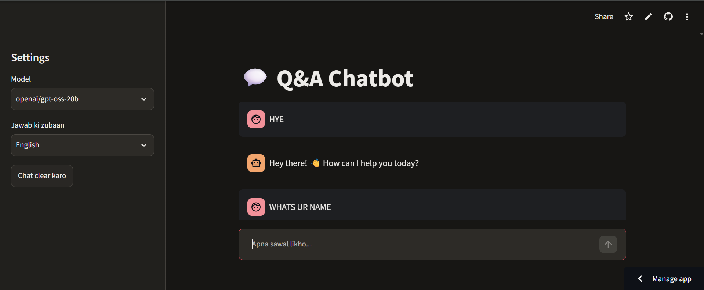

# 💬 Q&A Chatbot

A simple conversational Q&A chatbot built with **LangChain**, **Groq** and **Streamlit**.

🔗 **Live demo:** [Open the app](https://qnachatbot-j5msjyeskkxdubmahz8smf.streamlit.app/)



## Features

- Multi-turn chat with conversation memory
- Streaming responses (text appears word by word)
- Choose the model (`gpt-oss-20b` / `gpt-oss-120b`) from the sidebar
- Choose the answer language (Roman Urdu / English)
- Clear-chat button and basic error handling

> **Note:** the demo runs on the Groq free tier, so it may occasionally hit rate limits. Each session is capped at 20 questions.

## Tech Stack

Python · LangChain · Groq API · Streamlit

## How It Works

```
User question → Prompt Template (system rules + chat history + question)
              → Groq LLM → Output Parser → streamed answer
              → saved in st.session_state (memory for the next turn)
```

LLMs are stateless, so the app stores the conversation in `st.session_state` and sends it with every request.

## Run Locally

```bash
pip install -r requirements.txt
```

Create a `.env` file in the project folder:

```
GROQ_API_KEY=your_groq_api_key
```

Then run:

```bash
streamlit run app.py
```

## Deploy

Deployed on Streamlit Community Cloud. The API key is added under **Secrets**:

```toml
GROQ_API_KEY = "your_groq_api_key"
```

## Project Structure

```
qna_chatbot/
├── app.py             # Streamlit app + LangChain chain
├── requirements.txt   # Dependencies
├── .gitignore         # Keeps .env out of GitHub
└── README.md
```

## Next Steps

- Add RAG to answer from custom documents
- Add voice input/output
